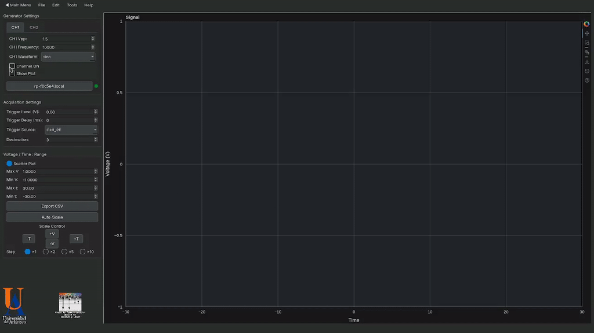
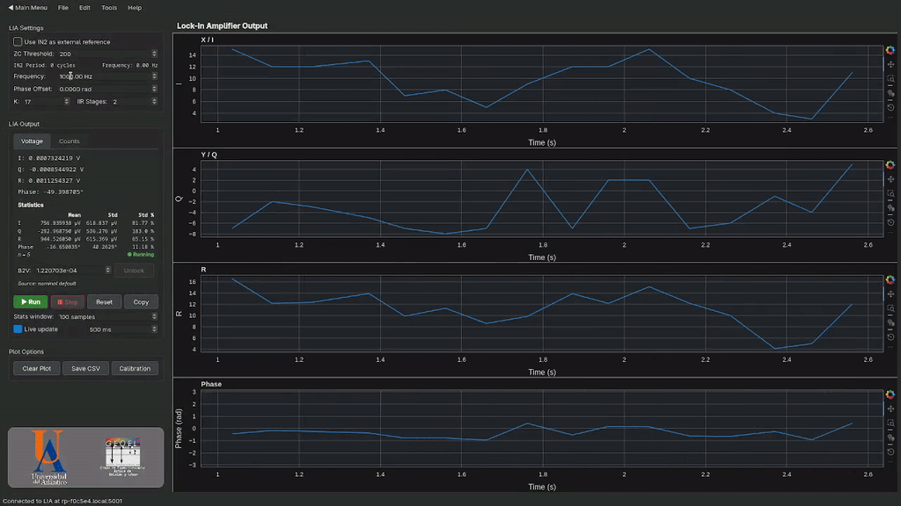
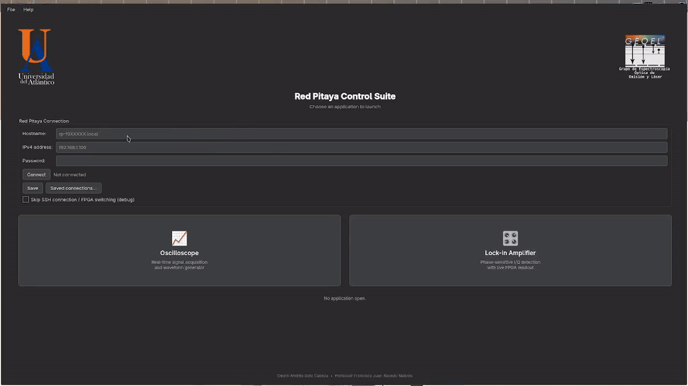

# Red Pitaya LIA and Oscilloscope Impementation

> A Python-based graphical user interface for an oscilloscope and signal generator, featuring an FPGA-based lock-in amplifier capable of recovering signals buried in noise at an input signal-to-noise ratio (SNR) of −55 dB.

[](#)
[](LICENSE)
[](#)

## Table of Contents

- [About](#about)
- [Features](#features)
- [Demo](#demo)
- [Getting Started](#getting-started)
  - [Prerequisites](#prerequisites)
  - [Installation](#installation)
- [Usage](#usage)
- [Roadmap](#roadmap)
- [Contributing](#contributing)
- [License](#license)
- [Contact](#contact)
- [Acknowledgments](#acknowledgments)

## About

Measuring very weak signals is difficult when noise is much larger than the signal itself. A **lock-in amplifier** solves this by multiplying the input with a reference at the signal's frequency and low-pass filtering the result, so that only the component coherent with the reference survives.

This project implements that technique on an **FPGA**, and provides a **Python desktop interface** to control and visualize it. The same hardware and GUI also work as a basic **oscilloscope** and **signal generator**, so a complete experiment (generate, acquire, recover) can be run from one tool.

**Target:** recover a signal whose amplitude is **−55 dB relative to the noise**, i.e. roughly 1/562 (≈ 0.18 %) of the noise amplitude.

## Features

**Oscilloscope**
- Real-time waveform display with adjustable time base and vertical scale
- Trigger controls (edge, level, source)
- Cursors and automatic measurements (Vpp, RMS, frequency)
- FFT / spectrum view

**Signal Generator**
- Waveforms: sine, square, triangle, and noise
- Adjustable frequency, amplitude, offset, and phase
- Optional noise injection to test lock-in performance at a chosen signal-to-noise ratio

**Lock-in Amplifier**
- Internal or external reference
- Quadrature outputs **X** and **Y**, magnitude **R**, and phase **θ**
- Configurable low-pass filter (time constant and roll-off order)
- Real-time plots of X, Y, R, θ versus time
- Data logging to CSV / HDF5

**General**
- Connection manager for the FPGA board
- Save/load of instrument settings
- Light and dark theme

## Demo

The following demonstrations showcase the system's graphical interface and its main functionalities, including real-time signal visualization, oscilloscope operation, and lock-in amplifier measurements.

<p align="center">
  
  
</p>

## Getting Started

Start the application with exceutable inside dist.

Set up the hostname of your Red Pitaya and password and have fun!

<p align="center">
  
</p>

### Prerequisites

List what needs to be installed before running the project:

- [uv](https://docs.astral.sh/uv/)
- [Git](https://git-scm.com/)

### Installation

```bash
# Clone the repository
git clone https://github.com/EhwazM/RedPitaya_python_app

# Move into the project directory
cd RedPitaya_python_app

# Copy the server code and top binary into your redpitaya
scp extras/rp_lia_top.bit.bin root@rp-f0xxxx.local:/root
scp extras/lia_server_monitor.py root@rp-f0xxxx.local:/root

# Install dependencies
uv add -r requirements.txt

```
## Usage

Show the most common ways to run and use the project.

```bash
# Start the application with
uv run main.py
```

<!-- ## Project Structure

```text
RedPittaya_python_app
├── app
│   ├── paths.py
│   ├── __pycache__
│   ├── redpitaya_scpi
│   ├── rp_data_acquisition
│   ├── rp_lia
│   ├── rp_plot
│   ├── rp_ssh
│   └── ui_pyside
├── dist
│   ├── main
│   └── RedPitayaSuite
├── docs
│   ├── dark_theme.py
│   ├── geoel.png
│   ├── geoel.webp
│   ├── Logo_de_la_Universidad_del_Atlántico.svg.png
│   ├── __pycache__
│   ├── Red_Pitaya_pinout.jpg
│   ├── ua.png
│   └── ua.svg
├── examples
│   ├── easing
│   └── widgetsgallery
├── extras
│   └── lia_server_monitor.py
├── License,md
├── main.py
├── pyproject.toml
├── README.md
├── RedPitayaSuite.spec
├── requirements.txt
├── test
│   ├── First_test.csv
│   ├── Hola_CH1-2_PreTrigger_3.csv
│   ├── Hola_CH1_PreTrigger_2.csv
│   ├── Hola_CH1_PreTrigger.csv
│   ├── lock_in.ipynb
│   ├── scpi_commands.ipynb
│   ├── testing_plots.ipynb
│   └── test.ipynb
└── uv.lock
``` -->

## Roadmap

- [x] Initial release.
- [ ] Oscilloscope MATH function for Internal operations and a good FFT.
- [ ] Improve Red Pitaya LIA filter setting time for high values of K and n_stages.

See the [open issues](https://github.com/EhwazM/RedPitaya_python_app/issues) for the full list of proposed features and known bugs.

## Contributing

Contributions are welcome!

1. Fork the repository
2. Create a feature branch: `git checkout -b feature/my-feature`
3. Commit your changes: `git commit -m "Add my feature"`
4. Push to the branch: `git push origin feature/my-feature`
5. Open a Pull Request

Please make sure tests pass and follow the existing code style.

## License

Distributed under the MIT License. See [`LICENSE`](LICENSE) for more information.

## Contact

Dewin Andrés Soto Cabeza — dewinsoto24@gmail.com

Project link: [https://github.com/EhwazM/RedPitaya_python_app](https://github.com/EhwazM/RedPitaya_python_app)

## Acknowledgments

- [Resource or library you used](https://example.com)
- Thanks to my family, friends and girlfried for being so supportive of me
